# Managing the Pod Lifecycle and Container Health

## Undestanding Pod's Status

```bash
kubectl -n kiada describe pod kiada -o yaml
```

A pod’s status section contains the following information:

* The IP addresses of the pod and the worker node that hosts it
* The time the pod was started
* The pod’s quality-of-service (QoS) class
* The phase the pod is in
* The conditions of the pod
* The state of its individual containers

The phase and the conditions of the pod along with the states of its container are important in understanding a pod's life cycle.

### Understanding the Pod Phase

The pod’s phase provides a quick summary of what’s happening with the pod.

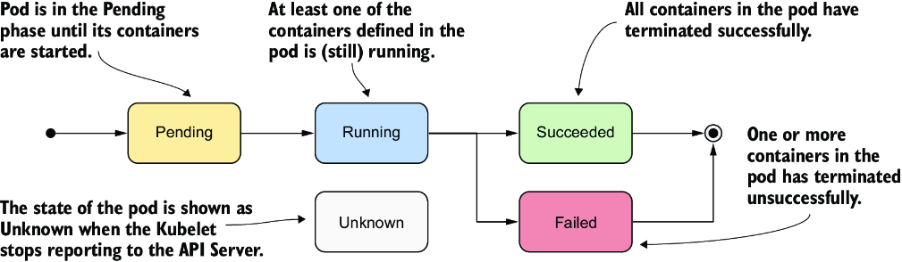

| Pod phase | Description |
| --- | --- |
| Pending | The initial phase starts after the Pod object is created. Until the pod is scheduled to a node, and the images of its containers are pulled and started, it remains in this phase. |
| Running | At least one of the pod’s containers is running. |
| Succeeded | Pods that aren’t intended to run indefinitely are marked as Succeeded when all their containers complete successfully. |
| Failed | When a pod is not configured to run indefinitely and at least one of its containers terminates unsuccessfully, the pod is marked as Failed. |
| Unknown | The state of the pod is unknown because the Kubelet has stopped reporting communicating with the API server. Possibly the worker node has failed or has disconnected from the network. |

```bash
$ kubectl -n kiada get pod kiada -o yaml | grep phase
phase: Running

$ kubectl describe po kiada
Name:         kiada
Namespace:    default
...
Status:       Running
...

$ kubectl get po kiada
NAME    READY   STATUS    RESTARTS   AGE
kiada   1/1     Running   0          40m
```

^^^For unhealthy pods, the STATUS column indicates what’s wrong with the pod.

### Understanding Pod Conditions

The phase of a pod says little about the condition of the pod. In contrast to the phase, a pod has several conditions at the same time. There are 4 condition types as of now:

| Pod condition | Description |
| --- | --- |
| PodScheduled | Indicates whether the pod has been scheduled to a node. |
| Initialized | The pod’s init containers have all completed successfully. |
| ContainersReady | All containers in the pod indicate that they are ready. This is a necessary but not sufficient condition for the entire pod to be ready. |
| Ready | The pod is ready to provide services to its clients. The containers in the pod and the pod’s *readiness gates* are all reporting that they are ready. |


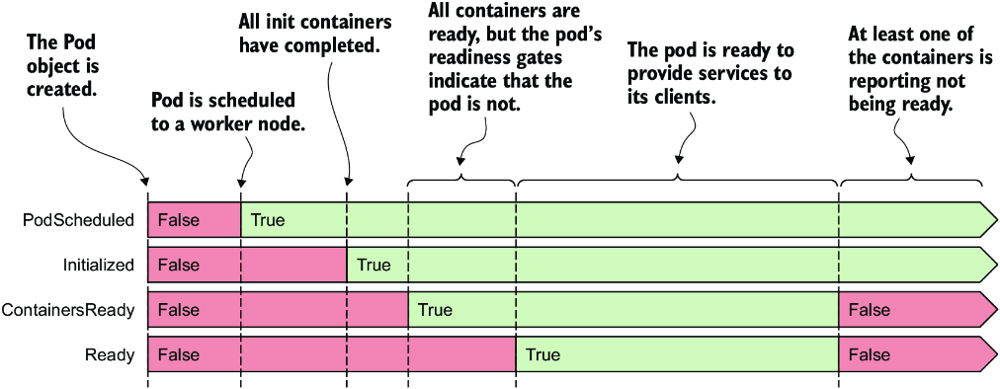

**Each condition is either fulfilled or not.**

* `PodScheduled` and `Initialized` conditions start as unfulfilled, but they are soon fulfilled and remain so throughout the life of the pod.

* In contrast, the `Ready` and `ContainersReady` conditions can change many times during the pod’s lifetime.

* Each object type has its own set of conditions, for instance a Node Object has – `MemoryPressure`, `DiskPressure`, `PIDPressure`, and `Ready`.

* The `Ready` condition is quite generic across all object types which indicates everything is fine with the object.


```bash
$ kubectl describe po kiada
...
Conditions:
  Type              Status
  Initialized       True
  Ready             True
  ContainersReady   True
  PodScheduled      True
...


$ kubectl get po kiada -o json | jq .status.conditions
[
  {
    "lastProbeTime": null,
    "lastTransitionTime": "2020-02-02T11:42:59Z",
    "status": "True",
    "type": "Initialized"
  },
  ...
]
```

The `kubectl describe` command shows only whether each condition is true. To find out why a condition is false, we need to inspect into the pod manifest.

* The `status` field that indicates whether the condition is True, False, or Unknown.

* The condition can also contain a reason field that specifies a machine-facing reason for the last change of the condition’s status, and a message field that explains the change in detail.

* The `lastTransitionTime` field shows when the change occurred, while the `lastProbeTime` indicates when this condition was last checked.


#### Pod Readiness Gate

A Pod can have `ContainersReady: True` while its overall `Ready` condition remains `False`. **Readiness gates** let you
require additional custom conditions before the Pod becomes Ready.

For example, during a rolling update, an application may pass its readiness probe before a cloud load balancer finishes
registering its backend. A readiness gate lets an external controller hold back Pod readiness until the load balancer
reports that backend as healthy.

Without readiness gates, Kubernetes may count the new Pod as available and begin removing an old Pod before the load
balancer can route traffic to the replacement. If too few healthy targets remain, requests can fail during this gap.

```yaml
spec:
  readinessGates:
    - conditionType: example.com/load-balancer-ready
  containers:
    - name: kiada
      image: avr2002/kiada:0.1
      readinessProbe:
        httpGet:
          path: /health
          port: 8080
```

A controller must update the matching condition in `status.conditions`. A missing condition is treated as `False`.
All containers must be ready and every configured gate must be `True` for the Pod to become Ready.


### Understanding the Container Status & State

* `state` field indicates the container’s current state
* the `lastState` field shows the state of the previous container after it has terminated.
* The container status also indicates the internal ID of the container (`containerID`), the image and `imageID` the container is running, whether the container is ready, and how often it has been restarted (`restartCount`).

The most important part of a container's status is its state.

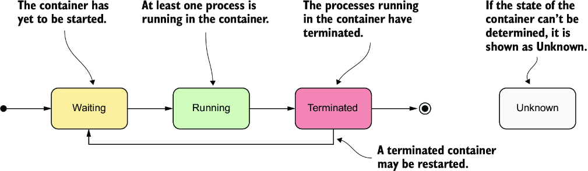

| Container state | Description |
| --- | --- |
| Waiting | The container is waiting to be started. The reason and message fields indicate why the container is in this state. |
| Running | The container has been created, and processes are running in it. The `startedAt` field indicates the time at which this container was started. |
| Terminated | The processes that had been running in the container have terminated. The `startedAt` and `finishedAt` fields indicate when the container was started and when it terminated. The exit code with which the main process terminated is in the `exitCode` field. |
| Unknown | The state of the container couldn’t be determined. |


```bash
$ kubectl describe pod kiada
...
Containers:
  kiada:
    Container ID:   docker://c64944a684d57faacfced0be1af44686...
    Image:          luksa/kiada:0.1
    Image ID:       docker-pullable://luksa/kiada@sha256:3f28...
    Port:           8080/TCP
    Host Port:      0/TCP
    State:          Running
      Started:      Sun, 02 Feb 2020 12:43:03 +0100
    Ready:          True
    Restart Count:  0
    Environment:    <none>
...


$ kubectl get pod kiada -o json | jq .status.containerStatuses
```


## Keeping Containers Healthy

Once the pod object is live, and if the main process in the container terminates for any reason, the Kubelet restarts the container.

### Pod's Restart Policy & Container Restarts

By default, Kubernetes restarts the container regardless of whether the process in the container exits with a zero or non-zero exit code. This behavior can be changed by setting the `restartPolicy` field in the pod’s spec.

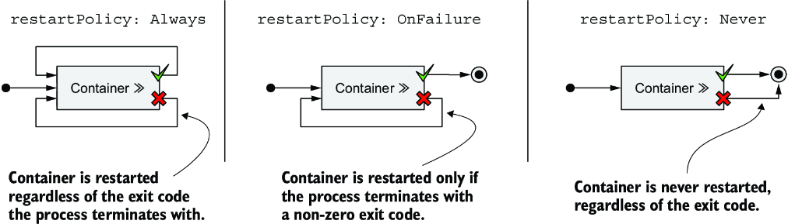

The restart policy is configured at the pod level and applies to all its containers.

| Restart policy | Description |
| --- | --- |
| Always | Container is restarted regardless of the exit code the process in the container terminates with. This is the default restart policy. |
| OnFailure | The container is restarted only if the process terminates with a non-zero exit code, which by convention indicates failure. |
| Never | The container is never restarted, not even when it fails. |

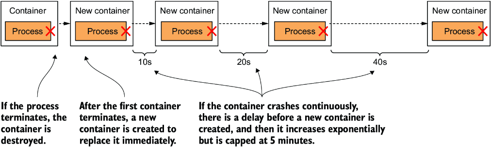

* The first time a container terminates, it is restarted immediately.
* The next time, however, Kubernetes waits 10 seconds before restarting it. This delay is then doubled to 20, 40, 80, and then to 160 seconds after each subsequent termination.
* From then on, the delay is kept at 5 minutes. This delay, which doubles between attempts, is called **exponential back-off**.

In the worst case, a container can therefore be prevented from starting for up to 5 minutes.

> The delay is reset to zero when the container has run successfully for 10 minutes. If the container must be restarted later, it is restarted immediately.

```bash
$ kubectl get pod kiada -o json | jq .status.containerStatuses
...
"state": {
  "waiting": {
    "message": "back-off 40s restarting failed container=envoy ...",
    "reason": "CrashLoopBackOff"
```

> When a container exits with status code 0, which means it hasn't crashed, so the `CrashLoopBackOff` status can be misleading.

### Liveness Probes

_Liveness Probe_ is a way, kubernetes can ask you application if it is alive and well. It can be defined for each container in the pod.

If the application doesn't respond, an error occurs, or the response is negative, the container is considered unhealthy and is terminated. The container is then restarted if the restart policy allows it.

> Liveness probes can only be used in the pod's regular containers and can't be defined in init containers.

This is helful in scenarios when the application can't catch certain errors by itself like:
* getting stuck into an infinite loop or deadlock.
* OR for example, a Java application with a memory leak eventually starts spewing out `OutOfMemoryErrors`, but its JVM process continues to run. Ideally, Kubernetes should detect this kind of error and restart the container.

#### Types of liveness probes

Kubernetes can probe a container with one of the following three mechanisms:

* An HTTP GET probe sends a GET request to the container’s IP address, on the network port and path you specify. If the probe receives a response, and the response code doesn’t represent an error (i.e., if the HTTP response code is 2xx or 3xx), the probe is considered successful. If the server returns an error response code, or if it doesn’t respond in time, the probe is considered to have failed.

* A TCP Socket probe attempts to open a TCP connection to the specified port of the container. If the connection is successfully established, the probe is considered successful. If the connection can’t be established in time, the probe is considered failed.

* An Exec probe executes a command inside the container and checks the exit code it terminates with. If the exit code is zero, the probe is successful. A non-zero exit code is considered a failure. The probe is also considered to have failed if the command fails to terminate in time.


> In addition to a _liveness probe_, a container can also have a _startup probe_ and a _readiness probe_.


#### Defining an HTTP GET liveness probe

```yaml
spec:
    containers:
    - name: kiada
        image: avr2002/kiada:0.1
        imagePullPolicy: Always   # Values can be Always, IfNotPresent, Never
        ports:
        - containerPort: 8080
        livenessProbe:
        httpGet:
            path: /health
            port: 8080
    - name: envoy
        image: avr2002/kiada-ssl-proxy:0.1
        ports:
        - name: https
        containerPort: 8443
        - name: admin
        containerPort: 9901
        livenessProbe:
        httpGet:
            path: /ready
            port: admin
        initialDelaySeconds: 10
        periodSeconds: 5
        timeoutSeconds: 2
        failureThreshold: 3
```

* For the kiada container, the HTTP GET request is sent to path `/health` (defined in app code) on port 8080. Since no other fields are specified, default settings are used – 
    * The first request is sent 10 seconds after the container starts and is repeated every 5 seconds.
    * If the application doesn’t respond within 2 seconds, the probe attempt is considered failed.
    * If it fails three times in a row, the container is considered unhealthy and is terminated.


    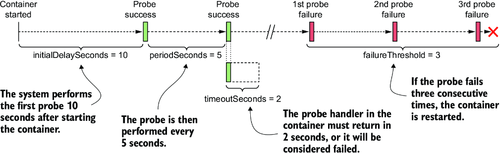

* For envoy proxy container, the built-in `/ready` endpoint is used. The parameters:

  * `initialDelaySeconds` determines how long Kubernetes should delay the execution of the first probe after starting the container. (default: 0s)
  * `periodSeconds` the amount of time between the execution of two consecutive probes. (default: 10s)
  * `timeoutSeconds` how long to wait for a response before the probe attempt counts as failed. (default: 1s)
  * `failureThreshold` how many times the probe must fail for the container to be considered unhealthy and potentially restarted. (default: 3)

#### Observing liveness probe

* Successful probes are not explicitly reported anywhere expect the application container logs whenever a HTTP GET request on the defined path is handled by it.

* The failed probes can be seen in the kubernetes events.

    ```bash
    $ kubectl -n kiada get events -w
    TYPE     REASON     MESSAGE
    Warning  Unhealthy  Liveness probe failed: HTTP probe failed with code 503
    Warning  Unhealthy  Liveness probe failed: HTTP probe failed with code 503
    Warning  Unhealthy  Liveness probe failed: HTTP probe failed with code 503
    Normal   Killing    Container envoy failed liveness probe, will be restarted
    Normal   Pulled     Container image already present on machine
    Normal   Created    Created container envoy
    Normal   Started    Started container envoy
    ```

To know how a container that fails its liveness probe is restarted, run the kubectl get/describe command to inspect the full manifest

```bash
$ kubectl describe pod kiada
Name:           kiada
...
Containers:
  ...
  envoy:
    ...
    State:          Running
      Started:      Sun, 31 May 2020 21:33:13 +0200
    Last State:     Terminated
      Reason:       Completed
      Exit Code:    0
      Started:      Sun, 31 May 2020 21:16:43 +0200
      Finished:     Sun, 31 May 2020 21:33:13 +0200
    ...
```

The exit code zero shown in the listing implies that the application process gracefully exited on its own. Had it been killed, the exit code would have been 137.

> Note: Exit code 128+n indicates that the process exited due to external signal n. Exit code 137 is 128+9, where 9 represents the KILL signal. You'll see this exit code whenever the container is killed. Exit code 143 is 128+15, where 15 is the SIGTERM signal. You'll typically see this exit code when the container runs a shell that has terminated gracefully.

### exec and tcpSocket Liveness Probe

For applications that don't expose HTTP health-check endpoints, the tcpSocket or the exec liveness probes can be used.

#### tcpSocket Liveness probe

For applications that accept non-HTTP TCP connections, a `tcpSocket` liveness probe tries to open a socket to the TCP port and if the connection is established, the probe is considered a success; otherwise, it’s considered a failure.

```yaml
    livenessProbe:
      tcpSocket:
        port: 1234
      periodSeconds: 2
      failureThreshold: 1
```

Above probe is configured to check whether the container’s network port 1234 is open. An attempt to establish a connection is made every 2 seconds, and a single failed attempt is enough to consider the container as unhealthy.

#### exec Liveness probe

Applications that do not accept TCP connections can use an exec liveness probe. It is a command that is executed inside the container and must therefore be available on the container's file system.

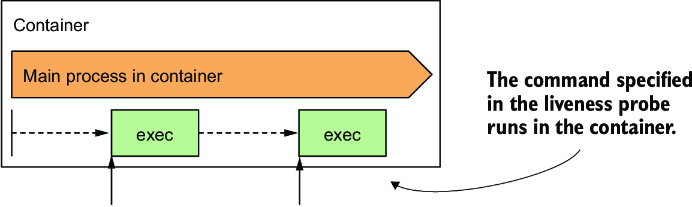

```yaml
    livenessProbe:
      exec:
        command:
        - /usr/bin/healthcheck
      periodSeconds: 2
      timeoutSeconds: 1
      failureThreshold: 1
```

Above example probe runs `/usr/bin/healthcheck` every 2 seconds to determine whether the application running in the container is still alive. If it returns a non-zero exit code or fails to complete within 1 second as specified in the `timeoutSeconds` field, the container is terminated immediately, as configured in the `failureThreshold` field, which indicates that a single probe failure is sufficient to consider the container unhealthy.

### Startup Probe

The container can be running before the application inside it is ready to accept requests. A slow-starting application may therefore fail its liveness probe even though it is still starting normally.

```text
Container started          <--- kubelet: "Started container kiada"
  │
  ├── import FastAPI, Jinja2, templates, static files
  ├── create the app
  ├── bind 0.0.0.0:8080
  └── "Uvicorn running on http://0.0.0.0:8080"
                              <--- now it can accept HTTP request
```

With the default liveness probe settings, an application generally has only 20–30 seconds to begin responding. If it takes longer, Kubernetes terminates and restarts the container. Repeated slow starts can trap the container in an endless restart loop.

```text
t = 0s   Container started (Java process is PID 1)
t = 5s   Still loading classes / connecting to the database
t = 20s  Still not listening on 8080
t = 30s  Tomcat: "listening on 8080"  <--- first successful HTTP request
```

The liveness probe could be made more tolerant by increasing `initialDelaySeconds`, `periodSeconds`, or `failureThreshold`, but this also delays the detection of failures after the application has started:

```text
Approximate failure-detection window = periodSeconds × failureThreshold
```

For applications that take minutes to start, using relaxed liveness settings for both startup and normal operation is undesirable. A startup probe allows each phase to use different settings.

#### Combining startup and liveness probes

When a `startupProbe` is configured:

1. Kubernetes executes only the startup probe while the application is starting.
2. Failures are expected and mean that the application has not finished starting.
3. After the startup probe succeeds once, Kubernetes stops running it and begins running the liveness probe.
4. If the startup probe reaches its `failureThreshold`, Kubernetes terminates the container as it would for a failed liveness probe.

```yaml
containers:
- name: kiada
  image: avr2002/kiada:0.1
  ports:
  - name: http
    containerPort: 8080
  startupProbe:
    httpGet:
      path: /health
      port: http
    periodSeconds: 10
    failureThreshold: 12
  livenessProbe:
    httpGet:
      path: /health
      port: http
    periodSeconds: 5
    failureThreshold: 2
```

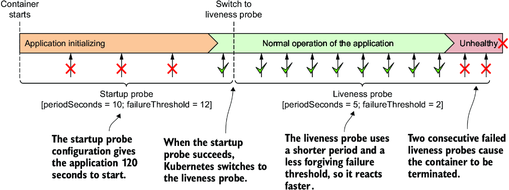

In this example:

* The startup probe allows up to `10 × 12 = 120` seconds for the application to start.
* After startup succeeds, the liveness probe checks every 5 seconds.
* Two consecutive liveness failures allow an unhealthy application to be detected in about 10 seconds.
* This allows fast detection of application health problems.

The startup and liveness probes usually use the same endpoint, but they may use different endpoints. A startup probe can also use `exec` or `tcpSocket` instead of `httpGet`.

### Creating Effective Liveness Probe Handlers

A liveness probe detects situations where the application process is still running but the application can no longer do useful work. Without one, Kubernetes can automatically restart the container only when its main process terminates.

However, an incorrect liveness probe can cause Kubernetes to restart a healthy application. If the application can reliably terminate itself when it becomes unhealthy, having no liveness probe may be safer than having a badly implemented one.

#### What a liveness probe should check

For a web application, even a simple probe that checks whether the server responds to an HTTP request can detect a nonresponsive server. A dedicated endpoint such as `/healthz` can additionally verify that the application's important internal components are functioning.

A good liveness endpoint should:

* Check only the application's internal health.
* Return quickly and use little CPU and memory.
* Not require authentication.
* Avoid depending on external services such as databases, backend APIs, or message brokers.

> If a frontend's liveness probe fails whenever its backend is unavailable, restarting the frontend cannot repair the backend. It can instead cause repeated restarts and turn one service failure into a cascading failure.

Probe execution consumes resources from the container's CPU and memory limits. Prefer a lightweight HTTP probe over an expensive `exec` probe, for example, in case of a Java app, an exec probe could be expensive because it would start an entire JVM just to check the health of the app.

#### Avoiding retry loops in probe handlers

Keep the probe handler simple and perform a single check. Use Kubernetes' `failureThreshold` to require several consecutive failures instead of implementing a retry loop inside the handler. This avoids duplicated retry logic and another potential point of failure.

## Executing Actions at Container Start-up and Shutdown

Using *lifecycle hooks* Kubernetes lets us run additional processes every time a container starts and just before it stops.

* These are of 2 types:

  * *Post-start* - hooks—Executed when the container starts
  * *Pre-stop* - hooks—Executed shortly before the container stops


* Lifecycle hooks are specified per container, as opposed to init containers, which are specified at the pod level.

* Like liveness probes, lifecycle hooks can be used to either execute a command inside the container, or send an HTTP GET request to the application in the container.
  
  * You can't specify both an `exec` and an `httpGet` post-start hook for a container. They are mutually exclusive.

* Similar to liveness probes, lifecycle hooks can only be applied to regular containers and not init containers.

* **When to use lifecycle hooks:**

  * If you’re the author of the application, you could perform the same operation within the application code itself, but if you need to add it to an existing application that you didn’t create yourself, you may not be able to do so. Lifecycle hook can provides a simple alternative that doesn’t require changeing the app or its container image.

### Understanding How a Post-Start Hook Affects the Container

```yaml
apiVersion: v1
kind: Pod
metadata:
  name: quote-poststart
spec:
  containers:
  - name: nginx
    image: nginx:alpine
    ports:
    - name: http
      containerPort: 80
    lifecycle:
      postStart:
        exec:
          command:
          - sh
          - -c
          - |
            apk add fortune && \
            curl -O https://luksa.github.io/kiada/book-quotes.txt && \
            curl -O https://luksa.github.io/kiada/book-quotes.txt.dat && \
            fortune book-quotes.txt > /usr/share/nginx/html/quote
          ## Failing the post-start hook:
          # command:
          # - sh
          # - -c
          # - "echo 'Emulating a post-start hook failure'; exit 1"
```

* **Runs concurrently with the main process:** The post-start hook does not run before the application's entrypoint. The application may already be running while the hook is still executing.

* **Delays completion of container startup:** Until the hook completes, the container can be reported as `Waiting` with reason `ContainerCreating`, even though its processes are running. Until then the the Pod remains in `Pending` phase.

* **Can temporarily block logs and port-forwarding:** During this startup period, Kubernetes can refuse log access and port-forwarding, despite the application process already running.

* **Failure terminates the container:** If the hook cannot execute or exits with a non-zero code, Kubernetes kills the container. Whether it restarts depends on the Pod's `restartPolicy`; repeated failures can lead to `CrashLoopBackOff`.

* A `FailedPostStartHook` event reports the hook failure and may include its exit code and what it might have printed to stdout or stderr.

* If the hooks runs successfully, the output (if any) is not logged anywhere. For that the command must log to a file instead of stdout/stderr. The log file contents can be viewed lik: `kubectl exec my-pod -- cat logfile.txt`


### Using Pre-Stop hooks

* **Runs before the stop signal:** When Kubernetes stops a running container, it executes the pre-stop hook before _sending the main process its stop signal (normally `SIGTERM`)_. The hook can execute a command, send an HTTP GET request, or introduce a sleep delay.

* **Supports graceful shutdown:** The hook can initiate shutdown or perform cleanup without changing the application code. For example, Nginx's graceful quit action stops accepting new connections and allows in-flight requests to finish, whereas its `SIGTERM` handling performs a fast shutdown.

* **Failure does not prevent termination:** If the hook cannot execute or returns a non-zero exit code, container termination still proceeds. A `FailedPreStopHook` warning event reports the failure, which may not be apparent from the Pod's status alone.

* **Runs on Kubernetes-initiated stops:** The hook can run during Pod shutdown or a container restart caused by a failed liveness probe. It is not called when the application process exits on its own.

* **Fix signal forwarding at the source:** A shell used as the container's main process may not forward `SIGTERM` to the application. Prefer the exec form of `ENTRYPOINT` or `CMD`; wrapper scripts should replace themselves with the application using `exec`, or explicitly forward signals. Adding a pre-stop hook just to forward `SIGTERM` does not fix the underlying problem.

* **Applies to a container, not the entire Pod:** A pre-stop hook can run multiple times during a Pod's lifetime as its container is restarted. Do not treat it as an action that runs only once when the whole Pod shuts down.

#### Why an Application Might Not Receive SIGTERM

During normal container shutdown, the container runtime sends the stop signal (usually `SIGTERM`) to the container's main process, PID 1. **The signal can reach PID 1 correctly without ever reaching the application**, if a shell sits between them.

For Kiada, `uvicorn main:app --host 0.0.0.0 --port 8080` serves the FastAPI `app` defined in `main.py`.

The **shell form** of a Dockerfile's `ENTRYPOINT` runs the command through a shell:

```dockerfile
ENTRYPOINT uvicorn main:app --host 0.0.0.0 --port 8080
```

The process structure can look like this:

```text
Container
└── /bin/sh -c "uvicorn main:app --host 0.0.0.0 --port 8080"    PID 1 ← receives SIGTERM
    └── uvicorn main:app --host 0.0.0.0 --port 8080             Child process
```

Signals sent to a parent process do not automatically propagate to its children. If the shell does not forward `SIGTERM`, the application continues running and its shutdown handler is never called. It may eventually be forcibly stopped when the termination grace period expires, without getting a chance to finish requests or clean up.

The **exec form** avoids introducing this shell:

```dockerfile
ENTRYPOINT ["uvicorn", "main:app", "--host", "0.0.0.0", "--port", "8080"]
```

```text
Container
└── uvicorn main:app --host 0.0.0.0 --port 8080    PID 1 ← receives SIGTERM directly
```

The same distinction applies to `CMD` when it is used to launch the application. Receiving the signal is only the first step; the application must also handle it appropriately for graceful shutdown.

**Startup scripts can introduce the same problem**, even when the Dockerfile uses exec form:

```dockerfile
ENTRYPOINT ["/app/start.sh"]
```

If the script simply runs `uvicorn main:app --host 0.0.0.0 --port 8080`, its shell can remain PID 1 with the server as a child. After performing initialization, the script should use `exec`:

```sh
#!/bin/sh
# Perform initialization here...
exec uvicorn main:app --host 0.0.0.0 --port 8080
```

Here, **`exec` replaces the shell with the application**, keeping the same PID instead of starting another child process. If the wrapper must remain running, it needs to explicitly forward signals and wait for the application to exit.

Adding a pre-stop hook just to send `SIGTERM` manually treats the symptom. Fixing the entrypoint or wrapper script allows the normal shutdown signal to reach the application.


## Understading Pod Life Cycle

When a Pod object is created, Kubernetes schedules it to a worker node that then runs its containers. The pod’s life cycle is divided into the three stages:

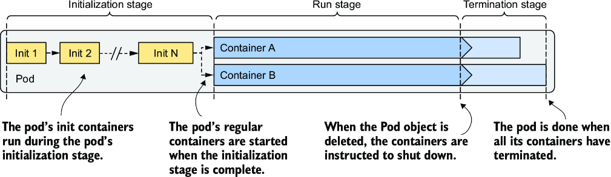

1. The *initialization stage*, during which the pod’s init containers run.
2. The *run stage*, in which the regular containers of the pod run.
3. The *termination stage*, in which the pod’s containers are terminated.

### Initialization Stage

**Pulling the Image**

* First the container image is pulled to the worker node. The `imagePullPolicy` field controls when Kubernetes pulls a container image. It is also applied every time the container is restarted.

| Image pull policy | Description |
| --- | --- |
| Not specified | Defaults to `Always` when the image tag is `:latest` or omitted; otherwise defaults to `IfNotPresent`. |
| `Always` | The kubelet contacts the image registry each time it starts the container and checks the image reference. If the image is already cached by digest, it can reuse the cached layers without downloading them again. |
| `IfNotPresent` | Pulls the image only when it is not already present on the worker node. |
| `Never` | Never pulls the image. It must already be available on the worker node. |


**Running the Containers**

* Init containers run in the order specified in the `initContainers` field in the pod's spec.

* If the container terminates with an error and the pod’s restart policy is set to `Always` or `OnFailure`, the failed init container is restarted.

* If the policy is set to `Never`, the subsequent init containers and the pod’s regular containers are never started.

* The pod's status is displayed as `Init:Error` indefinitely, we would then have to delete and recreate the Pod object to restart the application.

* Init containers are normally only executed once. Even if one of the pod’s main containers is terminated later, the pod's init containers are not re-executed. But if the entire pod needs to be restarted, they may be executed again. This means, **the operations performed by init containers must be idempotent.**

### Run Stage

Once all regular init containers complete successfully, the kubelet starts the pod's regular containers. Each container can start and terminate at a different time.

**Pulling the Image**

* Before creating each container, the kubelet makes its image available according to the `imagePullPolicy`.

* If an image pull is slow or fails, the pod's other containers can still start. Containers that depend on each other should not assume they will all start at the same time.

**Running the Containers**

* The container starts when the main container process starts. If a post-start hook is defined in the container, it is invoked in parallel with the main container process.

* The post-start hook runs asynchronously and must be successful for the container to continue running.

* If a startup probe is configured, the liveness and readiness probes wait for it to succeed. Without a startup probe, they can run without waiting for one.

> The kubelet can start regular containers in the order listed in the pod spec, and a slow `postStart` hook can delay the next container. This is an implementation detail and should not be relied on as a startup ordering guarantee.

**Terminating and Restarting Containers**

* When a startup or liveness probe reaches its failure threshold, Kubernetes terminates the container. The pod's `restartPolicy` determines whether it is restarted.

* A failed `postStart` hook also causes the container to be terminated and is subject to the restart policy.

* A failed `postStart` hook with `restartPolicy: Never` can still show the pod's status as `Completed`. Check the container's termination details and pod events to understand what happened.

* Regular containers generally terminate without a guaranteed order. A slow `preStop` hook delays its own container, but should not be used to order the shutdown of other containers. Native sidecars are stopped after the main containers, in reverse order of their declaration.

**Termination Grace Period**

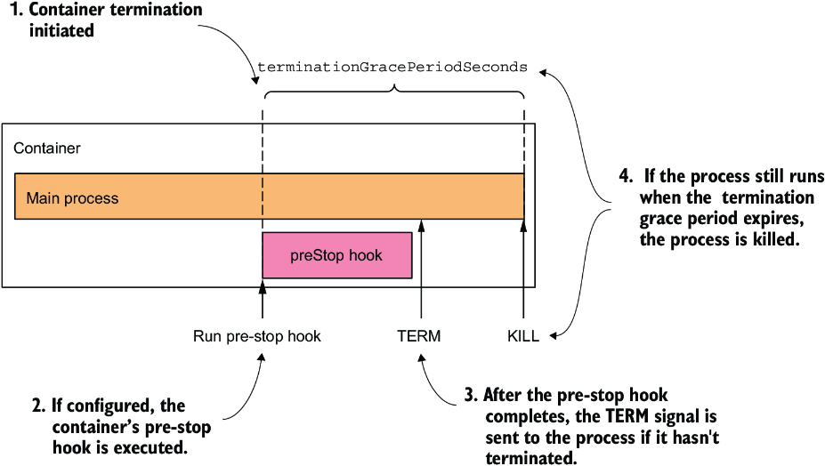

* When Kubernetes needs to stop a container, it runs the container's `preStop` hook, if defined, and then sends the main process a stop signal (normally `SIGTERM`). This gives the application a chance to finish its work and exit.

* The pod's `spec.terminationGracePeriodSeconds` defaults to **30 seconds**. The timer starts before the `preStop` hook runs, so the hook and the application's shutdown share the same time budget. If the process is still running when the period expires, Kubernetes forcibly kills it with `SIGKILL`.

* After termination, the container is restarted if the pod's `restartPolicy` allows it. Otherwise, it remains terminated while the pod's other containers can keep running.

### Termination Stage

Deleting a pod starts the shutdown of its containers. `kubectl` displays the pod as `Terminating` during this process; `Terminating` is not a pod phase.

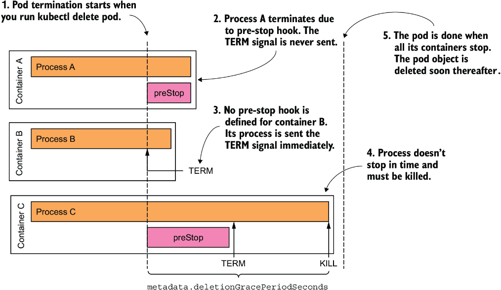

**Deletion Grace Period**

* The deletion request sets `metadata.deletionGracePeriodSeconds`, normally using the value of `spec.terminationGracePeriodSeconds`. The `kubectl delete --grace-period` option can override it for that deletion.

* Each regular container follows the same shutdown sequence: run its `preStop` hook, send the stop signal, and force-kill it if the deadline expires. Their shutdowns can happen concurrently. Kubernetes removes the Pod object after its containers have stopped.

* A zero-second deletion grace period skips `preStop` hooks. Give applications enough time to finish in-flight work; shortening the period can turn a slow graceful shutdown into a forced kill.


## Visualizing the full life cycle of the pod’s containers

Pod's Initialization Stage:

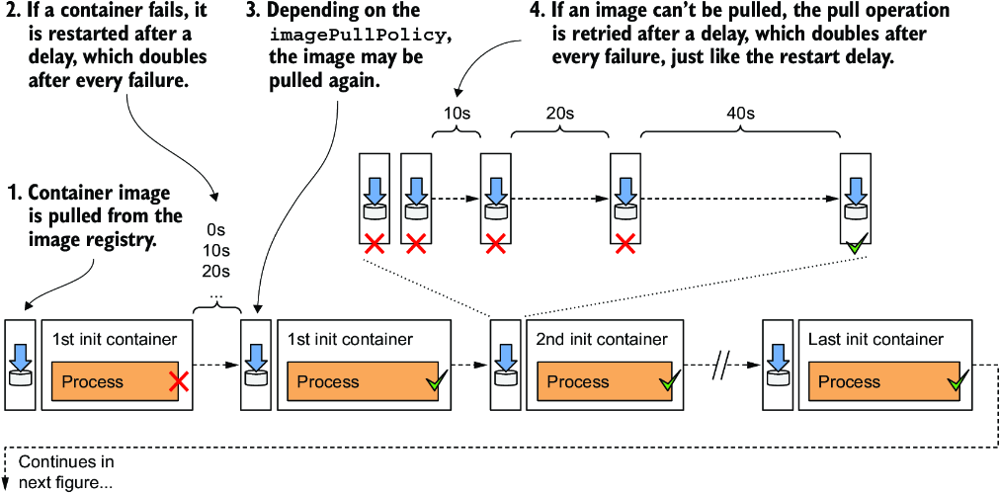

Pod's Normal Operation:

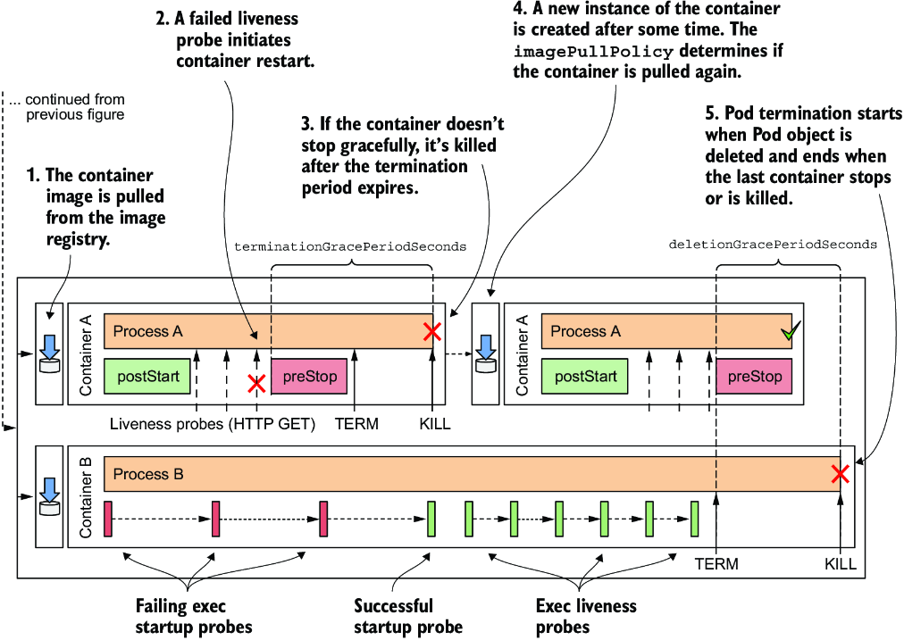


> Note: If an init container’s `restartPolicy` is set to `Always`, the init container is a sidecar container and is not expected to terminate. Thus, the next init container is started after the sidecar container fully starts.

> Note: If the Pod contains native sidecar containers, they are terminated after all the regular containers have terminated. The sidecars are terminated in the reverse order of their appearance in the `initContainers` list.

